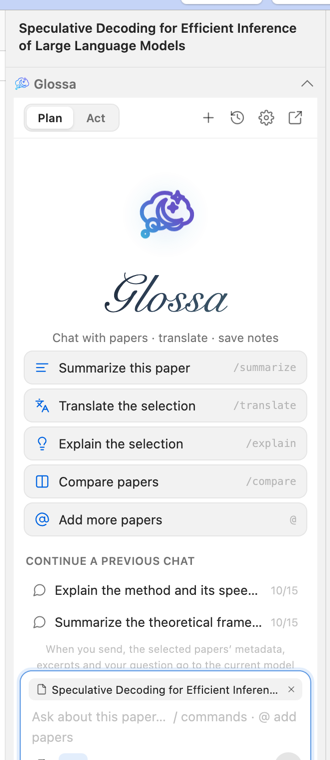
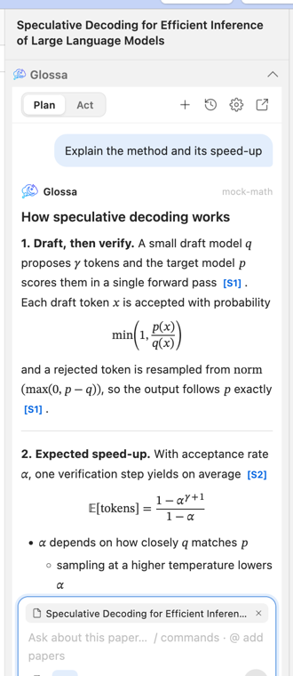
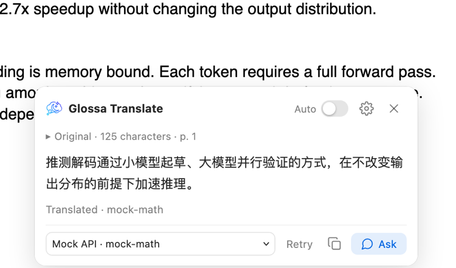

# Glossa for Zotero

**English** · [简体中文](README.zh-CN.md)

A research assistant inside Zotero: chat with your papers, translate PDF selections, and turn answers into Zotero notes — with sources you can click back to and formulas that render properly.

Glossa uses your own model service: an OpenAI-compatible or Anthropic API key, a local model (Ollama, LM Studio), or the Codex, Claude Code or Grok command-line tools you are already signed in to.

| Chat with a paper | Formulas and sources | Quick translation |
| --- | --- | --- |
|  |  |  |

Screenshots: Zotero 10 with a synthetic test library and a local mock model service.

## Install

1. Download `glossa-zotero-x.y.z.xpi` from the [latest release](https://github.com/yiiwang118/zotero-glossa/releases/latest).
2. In Zotero, open **Tools → Plugins** and drag the file into the window (or use the gear menu → **Install Plugin From File…**).
3. Select a paper and click the Glossa icon in the item pane's side navigation.

Requires **Zotero 10.0.6 or later 10.x**. Installed copies update automatically from this repository's releases. Tested on macOS; Windows and Linux should work but are not tested yet — please [open an issue](https://github.com/yiiwang118/zotero-glossa/issues) if something breaks.

## Getting started

1. Click the model name below the chat input → **Add an API service**. Pick a preset (OpenAI, Anthropic, Gemini, DeepSeek, OpenRouter, Moonshot, Qwen, Zhipu, SiliconFlow, xAI, Ollama, LM Studio) or enter an address, paste your API key, press **Fetch models**, choose one and save.
   To use a local CLI instead, choose Codex, Claude Code or Grok under **Local CLI** in the same menu — no API key needed.
2. Ask a question, or start with a command: `/summarize`, `/translate`, `/explain`, `/compare`. Type `@` to add more papers.
3. Select text in a PDF to translate it, ask about it, or have it attached to your next question.
4. Switch to **Act** and press **Save as note** to keep an answer as a child note of the paper.

## Features

- **Reads what you are reading** — item metadata, abstract, annotations, the current PDF selection and, when *Full text* is on, the first 40 pages of the PDF (EPUBs and web snapshots through Zotero's full-text index). Up to six papers per question for comparisons.
- **Answers you can check** — streamed Markdown with tables and code, `[S1]` citations that jump to the paper, page or annotation, and a list of the excerpts that were sent.
- **Formulas** — models are asked to write LaTeX (`$…$`, `$$…$$`); Glossa renders it as MathML with [Temml](https://temml.org) and saves it in Zotero's native note math format. Amounts like “$5 and $10” stay text.
- **Visible reasoning** — the thinking of DeepSeek, Qwen, Kimi, OpenRouter, Anthropic, local `<think>` models and the CLIs appears in a collapsible card, with live status (connecting, queued, thinking, answering) and elapsed time.
- **Quick translation** — *Translate* and *Ask* buttons in Zotero's selection popup; translations stream in a small popover and can use a separate, faster service.
- **Local CLIs** — Codex (via `codex app-server`), Claude Code and Grok stream their answers, list their models and reasoning efforts, refresh those lists automatically, and report specific errors without exposing credentials.
- **Notes** — answers become child notes with headings, lists, tables, formulas and clickable `zotero://` source links. Existing notes are never modified.
- **History** — grouped by date, searchable, with folders, Markdown export and JSON backup. Chats keep running in the background while you read something else.
- **Sidebar or window** — use Glossa in the item pane or in its own window, and move a chat between them.
- **Chinese and English interface**, following Zotero's language or chosen in Settings; answers follow the interface language unless you pick another one.

## Privacy and data

- Nothing is sent until you press Send (or Translate, or enable automatic translation). A question sends your question, the last few complete turns of that chat, and the selected papers' metadata, abstract, excerpts and annotations to the service you chose — and nothing else from your library. Quick translation sends only the selected text.
- API keys are encrypted with Zotero's system keychain and never included in history exports. Chats are stored as plain JSON in `glossa-zotero/state.json` inside the Zotero data directory; back it up with the rest of that directory.
- Local CLIs run without a shell, read-only, in a private temporary folder, and Glossa never reads their credential files. They use their own accounts and data policies.
- CLIs use Zotero's network proxy (the system proxy by default) unless you set one per CLI in Settings. Zotero started from the Dock does not see proxy variables from your shell profile.
- Plugins have full access to Zotero and your computer; install Glossa only from this repository's releases.

## Limitations

- No OCR or image understanding; scanned PDFs need OCR first.
- At most six papers, 40 PDF pages per paper and 60,000 characters of context per question.
- Sources are where context came from; models can still misquote. Notes contain links, not structured citations.
- Chats do not sync between computers (notes you save do, through Zotero).

## Development

Requires Node.js 22+, npm and Python 3.

```sh
npm ci
npm run check            # release metadata, TypeScript, ESLint, tests, build, package verification
npm run test:browser     # optional UI tests; needs Playwright (see TESTING.md)
```

The build writes `dist/glossa-zotero-<version>.xpi`, its SHA-256 checksum and `dist/updates.json`. The only runtime dependency is Temml (MIT), bundled into the XPI together with its license.

```text
addon/      manifest, bootstrap, styles, window, Fluent strings and icons
src/core/   data model, storage, API and CLI protocols, prompts, Markdown, i18n
src/host/   Zotero items, PDF text, keychain, file dialogs and the Gecko process adapter
src/ui/     sidebar and window UI: panel, menus, settings, history, translation, math
tests/      protocol, storage, host-contract and UI tests
scripts/    release checks and release notes
```

### Releasing

1. Update the version in `package.json`, `addon/manifest.json` and `CLIENT_INFO` in `src/core/cli.ts`, and add a section to [CHANGELOG.md](CHANGELOG.md).
2. `npm run release:check -- <version>` and commit.
3. `git tag <version> && git push origin main <version>` (no `v` prefix).

The release workflow runs all checks and publishes the XPI, its checksum and `updates.json` to a GitHub release. The plugin's `update_url` reads `updates.json` from the latest release, so installed copies update automatically. To support a newer Zotero without code changes, raise `strict_max_version` and publish a release.

## License

[MIT](LICENSE). Includes [Temml](https://github.com/ronkok/Temml) (MIT, see `THIRD-PARTY-temml-LICENSE.txt` in the XPI). Test details are in [TESTING.md](TESTING.md) (Chinese).
