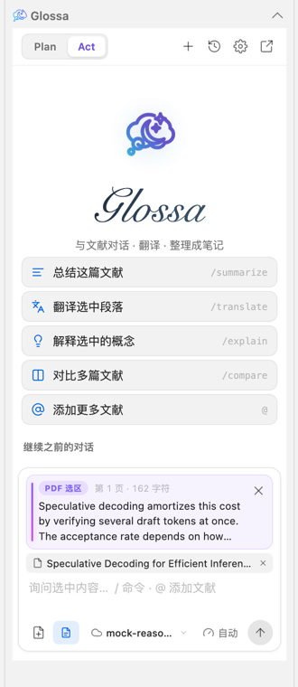
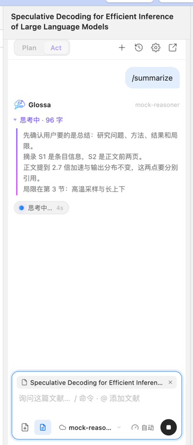
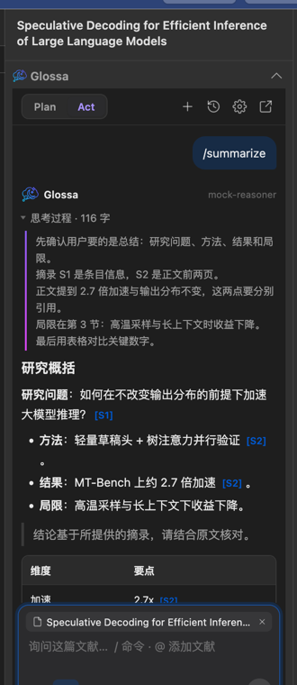
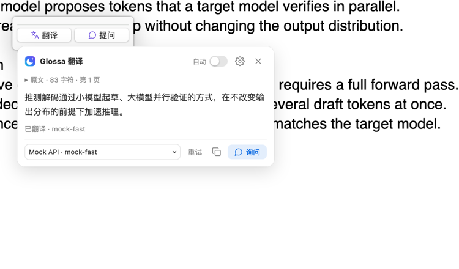

# Glossa for Zotero 验证记录

## 各轮验证摘要

- **0.2.0（2026-10-15，首个公开版本）**：`npm run check` 通过（72 项自动测试，另校验发布元数据与 `updates.json`：版本、XPI 的 SHA-256、下载地址与兼容范围），浏览器界面测试通过。0.2.0 在真实 Zotero 10.0.6 测试配置中安装启用，插件管理器读到新的主页地址和 `update_url`。在英文界面下重新截取 README 截图：一段推测解码回答渲染出 20 个公式且无错误，划词翻译浮层正常。
- **0.1.3（2026-10-15）**：`npm run check` 通过（72 项自动测试），浏览器界面测试通过。在真实 Zotero 中，一段包含行内公式、独立公式、分式、求和、上下标、表格内公式、嵌套列表、分隔线与引用的回答渲染为 14 个 MathML 公式，没有错误；保存为子笔记后，Zotero 笔记编辑器正确显示全部公式。
- **0.1.2（2026-10-15）**：`npm run check` 通过（70 项自动测试）。在真实 Zotero 10.0.6 独立配置中，以模拟 Dock 启动的干净环境（没有任何代理变量，PATH 仅系统默认）运行：插件解析出系统代理并传给 CLI；通过插件实际调用本机 Codex、Claude Code、Grok，三者均在 7–11 秒内开始流式输出；打开模型菜单后，Grok 的旧列表自动刷新出新模型；使用不存在的模型时只在回答卡片中显示一条具体错误。
- **0.1.1（2026-10-15）**：`npm run check` 通过（68 项自动测试）。0.1.0（含人为放慢关闭的旧版）覆盖安装为 0.1.1、停用后再启用、同版本重复安装，每种情况都只有一个侧栏区块、一组菜单和一个阅读器监听；独立窗口正常加载；重启后插件仍在列表中且已启用；侧栏图标与 Zotero 自带图标大小一致；真实拖选文字后点空白处，选区卡片随之撤下；中英文切换后已打开的面板就地刷新，草稿保留。
- **0.1.0 试用反馈修复（2026-10-15）**：`npm run check` 通过（66 项自动测试）；按“从文件安装”覆盖旧版后验证了原有图标、历史搜索框单一焦点框、API Key 只有一个显示按钮、阅读器选区同步到侧栏与独立窗口、独立窗口正常加载、“排队 → 思考 → 回答”的流式显示与折叠、翻译浮层的阶段提示。模型请求发往本机模拟服务。
- **全面修缮（2026-10-14）**：`npm run check` 通过（62 项自动测试）；浏览器界面测试在 320 / 390 / 960 px × 深浅主题下无横向溢出；真实 Zotero 10.0.6 中通过 Marionette 驱动独立测试配置完成安装与启用、侧栏与区块图标、模型菜单、添加 API 服务并获取模型列表、流式回答与来源、原生子笔记创建（含 zotero:// 来源链接）、历史菜单、常规设置、独立窗口、阅读器选区按钮与翻译浮层、深浅主题、条目右键菜单。

所有真实 Zotero 验证都在独立的测试配置与数据目录中进行，未接触日常文献库；截图中的文献为合成数据。


开发环境：macOS，Zotero 10.0.6。

## 2026-10-15 第四轮反馈（0.1.3）

| 反馈 | 原因 | 处理 |
| --- | --- | --- |
| 公式没有渲染，`---` 原样显示 | 读取存档中那条回答（只读）：DeepSeek 把公式写成 `C_jᵀ A_j⋯A_{i+1} B_i` 这样的纯文本，因为提示词没有规定公式格式；渲染器本身也不支持公式、分隔线、斜体和多级列表，连续的引用行会被拆成多块 | 提示词要求所有公式用 LaTeX（行内 `$…$`，独立公式单独成行 `$$…$$`）。渲染器支持 `$…$`、`$$…$$`、`\(…\)`、`\[…\]`：由 Temml 0.13.5（MIT，零依赖，许可证随 XPI 分发）生成公式树，插件按 MathML 元素、属性与样式白名单逐个 `createElementNS` 构建，模型输出不经过 HTML / XML 解析；`\href`、`\url`、`\includegraphics`、`\style` 等命令被拒绝；解析失败时保留源码，悬停提示给出原因；独立公式过宽时可横向滚动。行内 `$` 按 Pandoc 规则判定，且不能跨越反引号或中文，“$5 和 $10”保持原样；流式输出中尚未闭合的 `$$` 先显示源码，遇到空行即止，不会吞掉后文。新增分隔线、`*斜体*`、多级列表（含起始编号）与合并的引用块。保存笔记时公式转为 Zotero 笔记格式（`<span class="math">`、`<pre class="math">`） |

说明：已有回答里以纯文本写出的伪公式无法还原，需要重新提问。

## 2026-10-15 第三轮反馈（0.1.2）

| 反馈 | 原因 | 处理 |
| --- | --- | --- |
| 换什么模型都一直停在“已连接，等待模型输出…”，最后报 CLI 请求失败 | 读取用户 Zotero 进程的环境（只读）：从 Dock 启动的 Zotero 只有系统默认 PATH，没有终端 `~/.zshrc` 里的 `https_proxy=http://127.0.0.1:7890`，CLI 因此直连。在同样的环境下复现：Codex 的 WebSocket 连续超时，约 2 分钟后才改用 HTTPS 并回答；Claude Code 立即返回 “403 Request not allowed”；Grok 90 秒内没有任何输出。此外 Codex 的“Reconnecting… 2/5”只是重试通知，插件却把第一条就当成了致命错误 | CLI 默认使用 Zotero 的网络代理（经 Gecko 代理服务解析，默认即系统代理，支持 PAC 和手动代理）；设置中填写的代理、Zotero 环境里已有的代理变量优先；同时设置 `NO_PROXY=localhost,127.0.0.1,::1`。CLI 设置页显示当前实际使用的代理。Codex 改用 `codex app-server`：正文和思考摘要逐段流式输出，带 `willRetry` 的错误显示为“连接不稳定，正在重试（2/5）…”，只有回合失败才报错 |
| Grok 的模型不全，没有 grok-4.7 | Grok CLI 今天自动更新后才提供 grok-4.7；插件只在第一次选用时读取模型列表，之后一直沿用旧列表（4.6 / 4.5） | 打开模型菜单时在后台刷新已保存的 CLI 模型列表（每次运行 Zotero 期间最多每 30 分钟一次，失败时静默保留旧列表）；每个 CLI 旁增加刷新按钮 |
| 报错冗余 | 同一个错误同时出现在回答卡片、输入框上方的提示行（进度回调和任务失败各写一次），卡片里还多一行“没有收到正文”；文字也只有笼统的“CLI 请求失败” | 回答卡片出现后，错误和警告只在卡片中显示；“没有收到正文”只用于正常结束但没有正文的情况。错误内容取自 CLI 的实际报错（Codex 的回合错误、Claude Code 的合成错误消息、Grok 的 `errors`、异常退出时 stderr 的最后一条错误），去掉密钥、邮箱和本机路径并截断，再附上可能的解决办法（检查代理 / 重新登录 / 检查模型名称 / 稍后重试） |

验证：`npm run check`（70 / 70）、浏览器界面测试；真实 Zotero 中以无代理变量的环境启动后，实际调用三个 CLI 并记录流式时间线，复验模型列表刷新与单条错误显示。

## 2026-10-15 第二轮反馈（0.1.1）

| 反馈 | 原因 | 处理 |
| --- | --- | --- |
| 在 PDF 中取消选区后，右侧的选区卡片还在 | 只在出现新选区时更新卡片，没有处理取消选区 | Zotero 取消选区时会移除选区浮层；浮层里的 Glossa 按钮离开文档后，侧栏与独立窗口撤下对应卡片。焦点在 Glossa 面板内（正在输入问题）时保留；只撤下被取消的那段选区。已在真实阅读器中拖选后点空白处验证 |
| 需要英文模式 | 界面文字写死为中文 | 新增 `src/core/i18n.ts`，界面文字、错误提示、命令提示词与笔记模板都有中英两版；设置中“界面语言”可选跟随 Zotero / 简体中文 / English，切换后面板就地重建并保留对话与草稿；回答语言默认跟随界面语言。0.1.1 之前的存档里默认写入的“简体中文”迁移为“跟随界面语言”（中文界面下效果不变） |
| DeepSeek 没有回复 | DeepSeek 官方状态页当时正在处理“网页 / API 部分中断”事故，影响 deepseek-flash 所在的 V4.1 Flash API | 插件侧无需修改；5xx 已提示“服务繁忙，请稍后重试或切换服务” |
| 侧栏导航图标偏大 | 侧栏使用带留白的整幅 SVG，与其他图标比例不一 | 新增裁去留白的 `icon-16.svg` / `icon-20.svg`，侧栏使用 20px 版本；实测图标约 17.5×15.5 CSS 像素，与 Zotero 自带图标（15–20）一致 |
| 首次从文件安装后插件列表看不到它、独立窗口灰色；重启后插件消失；再装一次侧栏重复，停用再启用后恢复 | Zotero `plugins.js` 的升级流程是异步的：`onInstalling` 等待旧版异步关闭时，`onInstalled` 可能已在**同一个**作用域里启动新版；旧版关闭结束时把 `GlossaZotero` 置空并注销同名的 `chrome://glossa-zotero/` 包，误伤新版（独立窗口无法加载），新版实例成为孤儿，再次安装便重复注册 | `bootstrap.js` 的关闭改为同步完成（只有退出 Zotero 时才等待保存），启动前先清理作用域里残留的实例；每个实例注册唯一命名的 chrome 包，旧版无法注销新版的包；实例记录启动时间，拒绝发给前任的迟到关闭；监听 AddonManager 的安装 / 停用 / 卸载事件，在 Zotero 调用关闭前同步拆除；注册侧栏、菜单、阅读器监听前先清理同名残留。“插件列表看不到 / 重启后消失”未能用脚本复现（两种安装路径在测试配置中都正常列出并在重启后保留），推测与上述竞态导致的启动失败有关，但未证实 |

验证：`npm run check`（68 / 68）、浏览器界面测试；真实 Zotero 10.0.6 独立配置中复验升级（含慢关闭旧版）、停用 / 启用、重复安装、重启、独立窗口、侧栏图标尺寸、真实拖选与取消选区、中英文切换。真实 DeepSeek 未调用。

## 2026-10-15 试用反馈修复

| 反馈 | 原因 | 处理 |
| --- | --- | --- |
| 主图标被改了 | 上一轮把品牌图标重绘为月牙 | 恢复原有云月图标（`addon/icon.svg`、侧栏、区块标题、菜单、首页光晕图标与手写体字标、消息与翻译浮层头像），与启动前快照逐字节一致 |
| 历史搜索框出现两层焦点框 | 外框 `:focus-within` 与内部输入框的 `:focus-visible` 同时绘制 | 搜索框内的输入框不再绘制自己的焦点框 |
| API Key 有两个眼睛按钮 | Zotero 的密码框自带显示按钮，又加了一个 | 去掉自定义按钮，只保留原生按钮 |
| 独立窗口空白 | 窗口由主窗口的 `openDialog` 打开，是隶属于主窗口的对话框（截图中最小化按钮为灰色，标题为空，说明停留在初始空白文档）；挂载只依赖一次 `load` 事件 | 改用 Zotero 打开阅读器窗口的方式 `Services.ww.openWindow(null, …, 'chrome,dialog=no,…')`；轮询真实文档就绪后挂载；挂载出错时在窗口内显示原因；记住窗口大小与位置。测试实例中确认 `dialog=false`、无 opener、文档与面板正常 |
| 选中文本时侧栏 / 独立窗口底部也要显示 | 选区只在点“提问”时传入 | 阅读器选区事件同时推送给同一文献的侧栏面板和独立窗口，输入框上方显示“PDF 选区”卡片；设置中可关闭 |
| 回答要流式、思考过程要可见；DeepSeek 好像没有输出 | 读取用户本地状态（仅元数据）：第一次是 DeepSeek 返回 **HTTP 503 “Service is too busy”**，第二次在思考阶段被手动停止。DeepSeek 默认开启思考并先流式输出 `reasoning_content`，此前这些内容被丢弃，界面只显示“正在思考” | 数据流拆分为正文、思考、连接状态三类；思考过程卡片实时显示并在正文开始后折叠；状态胶囊显示连接 / 排队（SSE keep-alive）/ 思考 / 回答与用时；DeepSeek 使用其 `thinking` 开关与 low / high / max；5xx 等错误给出“服务繁忙，请稍后重试”而非“检查设置” |

验证：`npm run check`（66 / 66）、浏览器界面测试；真实 Zotero 中以“从文件安装”覆盖旧版后逐项复验，并用本机模拟服务复现 DeepSeek 式的排队、思考与回答过程。

## 2026-10-14 全面修缮

### 审查发现并已修复的问题

| 类别 | 问题 | 处理 |
| --- | --- | --- |
| 宿主兼容 | Gecko 的自动完成组件不在 chrome 文档中注册，`<datalist>` 在 Zotero 里不会弹出；推理强度只能手打，模型建议不可见 | 模型与推理强度改为面板内的可搜索菜单（`src/ui/menu.ts`） |
| 宿主兼容 | Zotero 平台样式对所有 `button` 设置 `max-height: 25px` 与负外边距，Glossa 的 28 px 按钮和两行列表项被压扁、文字重叠 | 在 `.glossa-panel` 内撤销该限制；真实 Zotero 中逐项测量确认 |
| 图标 | 面板内功能图标风格不一（大脑、选区等图标难以辨认） | 面板图标统一为 24 px、1.8 描边；品牌图标后来按反馈恢复原样（见 10-15） |
| 布局 | 文献标签被压到 25% 宽（只剩 “Sp”），三段下拉在窄侧栏中挤成一行 | 文献 / 选区标签独占一行；模型、推理强度、全文开关放到底栏 |
| 逻辑 | 默认 Plan 模式的系统提示要求“提出研究计划”，`/summarize` 可能得到计划而非总结 | Plan 改为只读地直接回答与分析；Act 生成可保存成稿 |
| 逻辑 | 保存笔记需要先切到 Act 再点确认，两步且分散 | 预览中一步“切换到 Act 并创建” |
| 逻辑 | 命令发出的对话标题都是同一句展开提示，历史无法区分；用户气泡显示的也是展开后的长提示 | 保存用户输入（`display`），标题为“总结 · 文献标题” |
| 逻辑 | 在侧栏切换到另一篇文献后，旧对话仍在，下一问会带着新文献发进旧对话 | 切换文献时开始新页面，旧对话留在历史；首页可继续这篇文献最近的对话；宿主重绘同一条目不再打断从历史打开的对话 |
| 逻辑 | 设置里只能编辑当前传输方式（API 或 CLI）的服务；回答语言混在每个服务表单里 | 设置分“常规 / 模型服务”两页，服务列表可直接编辑任一 API 或 CLI；增加常用服务预设 |
| 请求 | Anthropic `max_tokens` 固定 4096，长总结会被截断并报错；整体 180 秒超时会打断推理模型 | 默认 16,000 并可按服务设置；回答 10 分钟、翻译 3 分钟上限；`length` / `max_tokens` 给出明确提示 |
| 诊断 | HTTP 错误只显示状态码 | 显示服务 JSON 错误中的 `message`（截断并隐去 Key，不回显原始正文或 HTML） |
| 上下文 | 只读 PDF；元数据包含空字段和英文字段名 | EPUB / 网页快照读取 Zotero 全文索引；元数据只保留有值字段并使用中文标签 |
| 翻译 | 选区靠近页面底部时浮层可能超出视口 | 空间不足时显示在选区上方并向上增长，高度限制在可用空间内 |
| 翻译 | CLI 现在总会列出，未配置时快速翻译可能误启动未安装的 CLI | 翻译服务只列出已配置的 API 与已检测或已选用的 CLI |
| 菜单 | 条目右键菜单对独立笔记也显示 | `onShowing` 仅对文献与附件显示 |
| 其他 | 状态提示常驻不消失；历史中“请先停止回答”写到被遮住的状态栏；“Tools → 打开研究工作台”实际按偏好打开 | 临时提示 4 秒后清除；错误显示在当前页面；菜单文字改为“打开 Glossa” |

### 本轮验证

| 检查 | 结果 | 说明 |
| --- | --- | --- |
| `npm run check` | 通过 | 发布元数据、TypeScript、ESLint 0 warning、62 / 62 自动测试、XPI 构建、打包后启动 |
| 浏览器界面测试 | 通过 | `tests/browser.mjs` 用本机 Chrome 运行；320 / 390 / 960 px × 深浅主题；页面异常 0 |
| 真实 Zotero 10.0.6 | 通过 | Marionette 驱动独立配置与独立数据目录（`-no-remote -profile … -datadir …`），合成文献 + 本机模拟 SSE 服务 |

真实 Zotero 中逐项完成：安装临时插件、侧栏与区块图标、模型菜单、在设置中添加 API 服务并获取模型列表、`/summarize` 流式回答、引用与来源面板、原生子笔记创建（读取数据库确认父条目与 `zotero://` 链接）、历史与行菜单、常规设置、独立窗口与会话迁移、阅读器选区按钮与翻译浮层、深浅主题、条目右键菜单显示规则。阅读器部分调用 Glossa 注册的选区事件处理函数和真实阅读器文档，没有模拟鼠标划词。本轮未保存 API Key（系统密钥存储）、未调用付费模型或本机 CLI。

| 首页与选区 | 思考中 | 深色 | 选区翻译 |
| --- | --- | --- | --- |
|  |  |  |  |

以下为此前（2026-10-10 至 10-14）的验证记录。

## 结果

| 检查 | 结果 | 证据与范围 |
| --- | --- | --- |
| TypeScript | 通过 | 严格类型检查、无未使用变量 |
| ESLint | 通过 | 带类型规则，0 error / 0 warning |
| 自动测试 | 58 / 58 通过（当时） | 安装清单、工作台生命周期、后台并行、自动翻译、协议、存储、研究会话、原生宿主契约、生产 UI 交互、真实子进程管道 |
| XPI 构建 | 通过 | 独立包、版本一致、ZIP 校验、无 Node / Obsidian 运行时依赖；附 SHA-256 文件 |
| 打包后启动 | 通过 | 在仅提供宿主测试接口的 VM 中加载实际 bootstrap 与实际 bundle，注册 4 个入口并全部清理 |
| Fluent | 通过 | 菜单与侧栏 `.label`、导航 `.tooltiptext` 均有中英文定义 |
| 生产依赖审计 | 通过 | `npm audit --omit=dev --audit-level=high`，0 vulnerabilities |
| Codex CLI | 通过 | 本机能力发现返回 7 个模型及 effort；实际回答 `GLOSSA_OK` |
| Claude Code | 通过 | 本机能力发现返回 13 个模型及 effort；修复流式重复后实际回答 `GLOSSA_OK` |
| Grok CLI | 通过 | 本机能力发现返回 4 个模型及 effort；实际回答 `GLOSSA_OK` |
| 独立浏览器 UI | 通过 | Chromium 151.0.7922.34；真实生产 UI，合成文献与本地 HTTP/SSE 服务，页面异常 0 |
| 原 Obsidian 回归 | 通过 | 1,360 项测试；独立社区规则扫描 0 error / 0 warning；安全临时目录构建及 release 检查 |
| 真实 Zotero 安装与界面 | 通过 | 10 月 14 日通过 Computer Use 安装并启用；侧栏、独立工作台、设置页、正常退出与重新启动验证通过 |

独立的本机 CLI 连通性测试使用现有登录状态，只提交了极短的合成问题。能力列表随账号和 CLI 版本变化，以上数量仅记录本次实际结果。原生 Gecko 进程适配层在契约测试中连接真实测试进程；本机 CLI 联调通过测试用进程接口连接，不等同于在真实 Zotero 窗口里执行。后续的原生快速翻译验收单独记录在文末，已实际通过 Zotero 调用 Codex 翻译公开论文短句。

## 已验证的流程

- OpenAI / Anthropic：UTF-8 分片、SSE、多行事件、普通 JSON、结束原因、异常、断流、取消、模型发现。
- CLI：Codex / Claude / Grok 三种事件协议、模型与 effort 解析、分页、工具请求拒绝、停止及退出、临时目录与私有提示文件清理、stderr 排空。
- 数据：原子写入接口、串行保存、写入失败后的下一次保存、损坏或未知版本保护、重启时将未完成回答标为已停止、移除目录后保留对话、重复导入不覆盖现有记录。
- 密钥：不降级为明文；保留的 Key 不会被发送到更改后的域名；模型发现等待系统密钥解密时锁定目标地址。
- 上下文：发送时固定文献与模型；懒加载元数据、批注文本与位置；提取失败保留可用来源；PDF 读取取消后不发送请求。
- 笔记：Plan 阻止写入、Act 预览确认、目标必须属于当前回答的来源、保存前重新检查只读权限、重复点击只创建一次、原生 `saveTx()` 接口调用。
- Markdown：表格、列表、引用块、代码、粗体中的来源链接；HTML 转义；不执行模型返回的脚本或任意 URL。
- 浏览器操作：发送 → 流式回答 → 来源点击 → 复制 → Act 确认笔记 → 历史分组 → JSON / Markdown 导出 → API / CLI 切换 → 模型列表获取。
- 窗口：320、390、960 px，浅色 / 深色；无横向溢出，发送按钮可见；窄设置面板可滚动到保存；Escape 关闭弹层并恢复焦点。

## 本轮修复

1. Zotero 原生菜单和侧栏标题改用 Fluent `.label`，避免空白标签。
2. Claude Code 会把单个完成块放在 `assistant.message.content[0]`，即使它在流中的索引是 1。解析器按实际流块去重，避免正文重复，并补足末尾未推送的文本。
3. 本机进程 stdout / stderr 处理 UTF-8 字符中途拆分，避免把临时空字符串误判为 EOF。
4. 切换文献后到达的旧标题不会重新绑定旧文献；自动模型发现不会覆盖用户刚填写的模型。
5. 模型发现锁定 API 地址，防止等待解密期间修改地址导致旧 Key 被发往新服务。
6. 历史保留断流、超时和正文缺失提示，导出保留来源与未完成状态。

## 可查看的 UI 证据

截图已更新为本轮真实 Zotero 截图，见文首“本轮验证”。

## 原生宿主验证限制

真实 Zotero 安装、侧栏、独立工作台、设置页和重启加载已通过。PDF 选区入口、Codex 快速翻译及侧栏/窗口切换已完成原生验收。2026-10-14 全面修缮后，原生子笔记创建（`saveTx()`、父条目与来源链接）已在独立配置的真实 Zotero 中验证。PDF 页码回跳、系统密钥存储、历史与密钥恢复、卸载行为仍待原生验收。代码调用已对照本机 Zotero 10.0.6 源码核查，但这不能替代真实宿主操作。

独立 Firefox 在本机启动时报告进程沙箱及图形初始化错误，未能完成浏览器启动；未放宽其沙箱，改用独立 Chromium 完成可执行的界面测试。

## 复现

在独立的 `glossa-zotero` 项目根目录执行；不再依赖 Obsidian 项目的文件或 `node_modules`。

```sh
npm ci
npm run check

# 需额外安装 Playwright 和测试浏览器
GLOSSA_BROWSER=chromium npm run test:browser

# 可选：使用本机 CLI 登录状态
node tests/local-cli-smoke.mjs
node tests/local-cli-smoke.mjs --answer
```

构建只输出到 `dist/`，不会部署到 Obsidian 知识库。原版回归构建使用 `/tmp/glossa-zotero-obsidian-regression`，未写入 yiiwang 知识库。

## 独立项目迁移验证（2026-10-11）

- Zotero 源码、许可证、设计预览及 CI 已迁移到与 `glossa` 并列的 `glossa-zotero` 项目，初始化独立 Git 仓库；尚未连接或推送 GitHub 远程仓库。
- API 地址处理收进本项目 `src/core/api-url.ts`；构建和测试不再引用原仓库。开发依赖由自己的 `package.json` 和 `package-lock.json` 管理，执行 `npm ci` 后确认直接开发依赖均解析到本项目的 `node_modules`。
- 在新目录完成 `npm run check`：版本检查、类型检查、ESLint、42 项测试、XPI 构建及打包后验证全部通过。生产依赖审计为 0 vulnerabilities。
- 在新目录重新运行独立 Chromium UI 测试：问答、引用、笔记确认、历史导出、模型切换以及 320 / 390 / 960 px 深浅主题检查通过，页面异常为 0。
- 独立 CI / Release 的 YAML 已解析检查；版本检查接受 `0.1.0`，拒绝 `v0.1.0` 和不匹配的 `0.2.0`。GitHub 工作流尚未在远程运行。
- Obsidian 仓库的已跟踪文件恢复到迁移前版本，Git 工作区无差异；重新完成类型检查、1,360 项测试、临时目录构建和 `release:check`。
- 安装包为 `dist/glossa-zotero-0.1.0.xpi`，随附 SHA-256 校验文件。迁移不改变 Zotero 插件 ID 或本地数据位置；真实 Zotero 验收限制仍如上所述。

## 原生安装验证（2026-10-14）

- Zotero 首次拒绝安装，原因是 `applications.zotero.update_url` 缺失。对照本机安装器校验补齐字段，构建、发布检查和安装包验证共用清单校验器；回归测试覆盖必填字段缺失及非 HTTPS 地址。
- 发现独立工作台通过原始包地址打开时为空白窗口。改为注册 `chrome://glossa-zotero/content/` 资源并使用原生 XUL 窗口；关闭或升级时注销资源，启动失败时也清理。实际 bootstrap 的 VM 验证覆盖正常注销和加载失败回滚。
- 完整 `npm run check` 通过：严格类型、0 warning 的 ESLint、43 项测试、XPI 构建和打包后验证。
- 通过 Zotero 插件管理器安装本地 XPI，显示 **Glossa for Zotero 0.1.0 / Enabled**。选中文献后侧栏正常；展开工作台能显示文献标题、API/CLI、模型、Plan/Act、effort 和输入区；设置页可打开并关闭。
- 正常退出 Zotero 后重新启动，再次展开侧栏和独立工作台，确认插件持久启用且界面正常。没有填写密钥、发送真实文献或创建、修改文献库笔记。
- 最终 XPI SHA-256：`0a5e05a5157cbd8d06f050549185bc6e1fa2945a5e6914c41aa9bef67a2b6319`。
- 更新地址指向计划中的独立仓库，更新源尚未发布；当前通过本地 XPI 安装和更新。

## 首页与交互对齐（2026-10-14）

- 恢复云月矢量图标、Glossa 手写标题、纵向快捷命令与顶部 Plan/Act；移除重复品牌栏。输入区采用文献靠左、三段模型选择靠右的紧凑布局，输入框自动伸缩；统一发送、复制、历史和设置图标。
- `/` 命令按文献和选区校验后生成实际请求；`@` 和加号打开原生文献选择器；修复被移除的文献在宿主刷新后重新出现的问题，并拒绝过期选择器结果。API/CLI 各自记住服务，历史目录管理及备份收进更多菜单。
- 完整 `npm run check` 通过：48 项测试、严格类型检查、ESLint 0 warning、XPI 构建及打包验证。独立 Chromium 完成首页、快捷命令、模型搜索、原有问答链和 320/390/960 px 深浅主题检查，页面异常为 0，文件与模型保持同一行。
- 原生 Zotero 覆盖安装后发现同版本样式缓存；正常退出重开后，实测首页、图标、模式栏、输入区和快捷命令草稿均正常。开发包覆盖安装后的样式刷新方法已写入 README。
- 原生文献选择器实际选中条目并返回后，Glossa 显示两篇文献；移除额外标签后恢复单篇上下文。历史和设置面板可打开并关闭。中途电脑操控窗口绑定超时，重新绑定选择器后完成验证；没有向模型提交真实文献或修改文献库条目。
- 本轮安装包 SHA-256：`e0cf0c46eb1afd4d4ee648fbbcb1bd9e3a82152a982f9c4dfc1f68db5a8c140d`。


## 快速翻译与窗口选择（2026-10-14）

- 修复 PDF 的“Glossa 翻译”只打开工作台并填写草稿的问题。现在点击后在选区旁直接调用所选 API 或 CLI，流式显示译文；原文、页码、停止、重试、复制、设置及继续对话均在同一浮层。提高选区操作按钮高度与间距，不修改 PDF 文字层或原生蓝色选区。
- 快速翻译只提交所选文本，不提取正文、不附加对话历史、不写入文献库。覆盖 12,000 字符限制、90 秒超时、密钥解密期间取消、关闭后阻止旧结果回写，以及配置缺失后保留原文重试。
- 设置新增自动保存的“对话打开位置”和默认关闭的“选中文字后自动翻译”。工具菜单和选区问答遵循位置偏好，已有独立窗口会复用；侧栏与工作台切换携带文献、选区、对话和草稿。
- 原生验收发现 Gecko 的初始空文档卸载事件提前结束了窗口加载等待，导致首次展开丢草稿。将卸载清理绑定放到实际窗口加载后；生命周期测试模拟初始 unload，并断言草稿完整恢复。修复后已在原生 Zotero 验证首次展开及切回侧栏。
- CSS 直接打入脚本并注入带唯一 ID 的样式节点，升级时清理；实测同版本覆盖安装后不重启也能显示新浮层和设置，解决之前的样式缓存问题。
- 完整 `npm run check` 通过：54 项测试、严格类型检查、ESLint 0 warning、XPI 构建和打包校验。独立 Chromium 测试验证本地 SSE 流式翻译、仅选区请求、复制、Escape、配置偏好保存，以及 320 / 960 px 深浅主题和屏幕边缘布局；页面异常为 0。
- 原生 Zotero 10.0.6 中，选中公开论文的一段 47 字符短句后，点击“Glossa 翻译”直接出现浮层；本机 Codex 返回“Transformer 模型，尤其是仅解码器模型”，状态显示已翻译，没有打开独立工作台。翻译设置可定位到 Glossa 侧栏，继续对话会保留选区。
- 原生验证了“右侧栏 / 独立窗口”选项、窗口与侧栏双向切换保留草稿、独立窗口偏好下的选区问答携带文本和问题。未创建或修改文献库条目、批注或笔记。
- 最终安装包 SHA-256：`ed4fd8faf7019635afc1f9fde957d5289bc99924660543e7b2ff27f52c74aa27`。

## 自动翻译与后台并行（2026-10-14）

- 翻译浮层加入立即保存的“划词自动翻译”开关和明确的“询问”按钮；询问携带原文并遵循侧栏/独立窗口偏好。翻译服务单独记忆。默认关闭自动翻译，不修改 PDF 原生文字层或高亮。
- 自动翻译按阅读器文档分别防抖，同一阅读器只处理最后一次选区，不同阅读器不会互相取消等待中的触发。关闭开关后不再自动请求。
- 请求由插件共享的研究会话管理。新建对话、切换上下文、关闭面板或工作台只卸载视图，不停止已经发出的对话。退出或卸载插件仍会停止任务并等待保存；没有跨 Zotero 重启自动续跑。
- 历史在读取文献上下文时就显示任务标题和“运行中”旋转图标，完成或停止时实时移除标记；历史可单独停止任务。流式更新不重建正在编辑的历史行，保留重命名输入焦点；减少动态效果偏好下禁用旋转动画。
- 完整 `npm run check` 通过：58 项测试、严格类型、ESLint 0 warning、构建与打包校验。新增测试覆盖两条任务并行、所有视图关闭后继续、重新挂载恢复、定向停止、上下文提取期间状态和关闭插件清理。
- 独立 Chromium 实际发起两条受控 HTTP/SSE 请求，在新建对话、卸载并重新挂载视图后，历史仍显示两个运行标记；一条完成后剩一个，单独停止另一条后全部清除。翻译浮层开关及询问通过交互验证，320/390/960 px 深浅主题无横向溢出，页面异常为零。截图在 `.cache/browser/history-running-light.png`、`history-running-dark.png` 和 `translation-320-light.png`。
- 在真实 Zotero 中更新到本轮 XPI，安装文件与构建文件的 SHA-256 一致。设置开关切换并保存正常，测试后恢复关闭。通过现有 Codex 登录发送两条无文献上下文的虚构短文问题；第一条显示正在生成时新建对话，再发送第二条。只读核对本地历史，两条回答均为 complete，分别为 304 和 300 字符，无来源、无警告。
- 本轮原生拖拽选区遇到电脑操控工具 `noWindowsAvailable` 错误，且截图与可访问性树状态不一致；重新绑定、重置工具后仍未恢复。没有据此宣称完成自动划词的原生复验或原生运行图标的视觉验收。这两项已通过生产代码的自动测试/浏览器交互验证；之前的原生手动快速翻译验收仍见上一节。
- 最终安装包 SHA-256：`967e9a213be8162cac09fe88a6850d32b9c42bebca21e7cab43764e5a0692d5d`。本轮未修改 Obsidian 项目，未创建或修改 Zotero 文献、批注或笔记。
